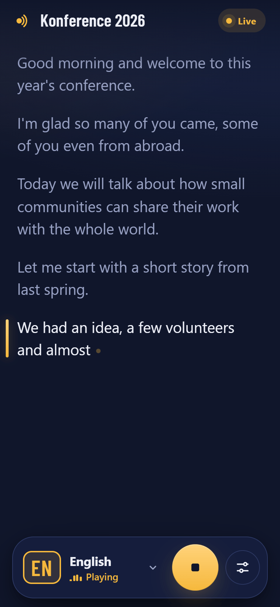
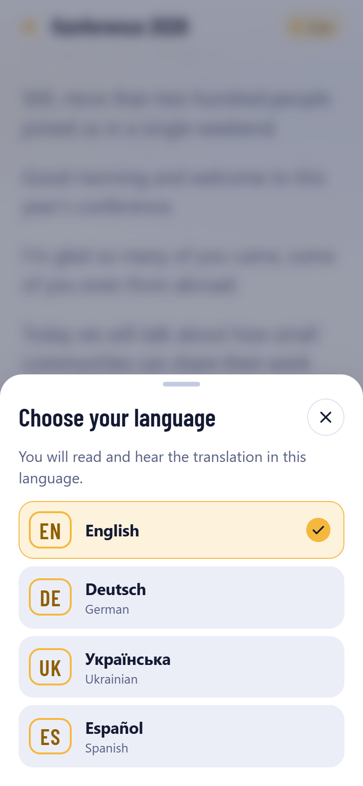
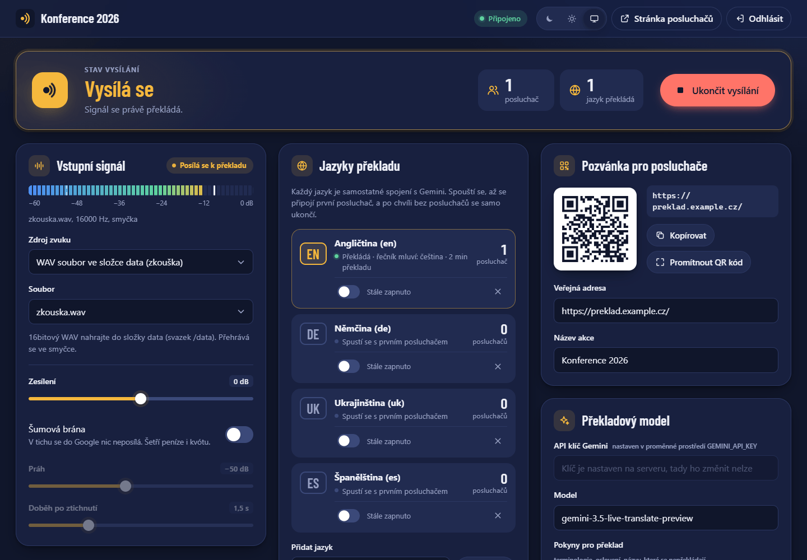

# Živý překlad

Živý překlad řeči na akcích přímo do telefonů posluchačů. Řečník mluví do mikrofonu jako
obvykle, posluchači naskenují QR kód, vyberou si jazyk a překlad **čtou i poslouchají** ve
vlastních sluchátkách. Bez instalace aplikace, bez účtu, bez půjčovny tlumočnických přijímačů.

Překládá model Gemini Live Translate od Googlu. Server běží v Dockeru na vašem počítači nebo
serveru a jeden zvukový signál překládá současně do tolika jazyků, kolik potřebujete.

<p align="center">
  
  &nbsp;
  
</p>
<p align="center">
  
</p>

**In English:** live speech translation for events, straight to the listeners' phones. The
speaker's audio goes through Google's Gemini Live Translate model; listeners scan a QR code, pick
a language and read and hear the translation. [More below](#in-english).

## Co umí

- **Text i zvuk:** přepis po větách a hlas překladu s nízkým zpožděním, volitelně i původní znění.
- **Telefon místo přijímače:** webová aplikace, kterou lze přidat na plochu. Rozhraní v 7 jazycích
  podle telefonu, tmavý i světlý vzhled, velikost písma, hraje i se zamčenou obrazovkou.
- **78 cílových jazyků.** Každý se připojí k Googlu až s prvním posluchačem a sám se vypne,
  když nikdo neposlouchá. V tichu se nic neposílá.
- **Konzole operátora:** zahájení a ukončení vysílání, měřič signálu se šumovou bránou, stav
  každého jazyka, QR kód k promítnutí na plátno, pokyny pro překlad (terminologie, oslovení).
- **Zdroj zvuku:** USB rozhraní mixpultu, vstup v prohlížeči operátora, nebo WAV soubor na zkoušku.
- **Stovky posluchačů na jednom serveru:** zvuk se kóduje jednou pro všechny (Opus kolem 20 kbps).
- **Spolehlivost:** samo se obnoví spojení s Googlem i s telefony, relace se předává bez výpadku,
  aplikace se otevře i bez připojení.

## Co budete potřebovat

- Počítač nebo server s **Dockerem** (Linux, nebo Docker Desktop na Windows a macOS).
- **API klíč Gemini** z [Google AI Studia](https://aistudio.google.com/app/apikey). Používání
  účtuje Google; každý jazyk je samostatná relace.
- **Zvuk řečníka:** výstup z mixpultu (třeba samostatný AUX jen s řečníky) přes USB zvukovou
  kartu, nebo vstup na počítači s prohlížečem.
- **Síť**, ve které telefony dosáhnou na server: Wi-Fi v sále nebo veřejná adresa. Nejlepší
  kvalitu dává doména s HTTPS (viz [HTTPS](#https-proč-a-jak)).

## Rychlý start

```bash
git clone https://github.com/hurtamartin/live-translation.git
cd live-translation
cp .env.example .env          # vyplňte ADMIN_PASSWORD (povinné) a GEMINI_API_KEY
docker compose up -d --build
```

1. Otevřete konzoli operátora `http://<server>:8080/admin` a přihlaste se heslem z `.env`.
2. V kartě **Vstupní signál** vyberte zdroj zvuku a ověřte, že měřič reaguje na řeč.
3. V kartě **Jazyky překladu** přidejte jazyky, do kterých se má překládat.
4. Vyplňte **Veřejnou adresu**, na které telefony server najdou (z ní se generuje QR kód).
5. Klikněte na **Zahájit vysílání** a promítněte QR kód tlačítkem **Promítnout QR kód**.

Posluchači otevřou `http://<server>:8080/` nebo naskenují QR kód a vyberou si jazyk.

`ADMIN_PASSWORD` je povinné: bez něj `docker compose` kontejner nespustí. Heslo se nikde
negeneruje ani nevypisuje do logu. API klíč lze zadat i v administraci; uloží se do svazku
`/data` (soubor `settings.json`, práva 600).

## Jak to funguje

Signál z mixpultu jde na server v Dockeru, ten ho posílá do modelu Gemini Live Translate
(`gemini-3.5-live-translate-preview`) a posluchačům na telefony rozesílá přeložený **text i zvuk**.
Telefony nepotřebují žádný API klíč ani instalaci.

```
 mixpult ──USB──▶ ┌──────────────── Docker: live-translation ─────────────────┐
                  │ zdroj zvuku ─▶ šumová brána ─▶ 16 kHz PCM (jednou)         │
 (nebo prohlížeč  │                                   │                        │
  operátora,      │             ┌─────────────────────┼──────────────┐         │
  nebo WAV)       │             ▼                     ▼              ▼         │
                  │      Gemini relace EN      Gemini relace DE    …  (wss)   │
                  │             │ text + 24 kHz zvuk                          │
                  │             ▼                                             │
                  │   kanál: přepis + takt 40 ms ─▶ Opus (1× kódováno)  ──────┼─▶ WebSocket ─▶ telefony
                  │                              └▶ MP3 (jen když poslouchá)──┼─▶ /stream/xx.mp3
                  └───────────────────────────────────────────────────────────┘
```

## Odkud server bere zvuk

| Zdroj | Kdy použít | Nastavení |
|---|---|---|
| **Zvuková karta serveru** | Server s Linuxem, USB rozhraní mixpultu zapojené do serveru | `docker compose -f docker-compose.yml -f docker-compose.alsa.yml up -d` a v administraci vyberte zařízení a kanál (mono kanál z vícekanálového rozhraní, např. 3 = AUX send pro překlad). |
| **Prohlížeč operátora** | Docker Desktop na Windows/macOS (USB zvuk se do kontejneru nepředá), nebo mixpult připojený k jinému počítači | V administraci zvolte „Prohlížeč na tomto počítači“, vyberte vstup a kanál (L/R/mix) a klikněte „Začít posílat zvuk“. Stránka musí zůstat otevřená. Prohlížeč pustí vstup jen přes `https` nebo `localhost`. |
| **WAV soubor** | Zkouška bez mixpultu | 16bitový WAV nahrajte do svazku `/data` (`docker cp nahravka.wav live-translation:/data/`). |

Zpracování zvuku z mixpultu je bez echo cancelling, AGC a potlačení šumu: mixpult dodává čistý linkový signál.
Nejlepší je poslat do serveru samostatný AUX/matrix výstup jen s řečníky (bez hudby).

## HTTPS: proč a jak

Na prostém `http://` přes IP adresu prohlížeč zakáže AudioWorklet, WebCodecs, service worker,
instalaci PWA i Wake Lock. Aplikace to zvládne (telefon automaticky přepne na MP3 stream
a text funguje), ale plnou kvalitu dává až HTTPS:

```bash
# .env: DOMAIN=preklad.example.cz  (A záznam míří na server, porty 80/443 otevřené)
docker compose --profile https up -d --build
```

Caddy si sám obstará certifikát Let's Encrypt (`deploy/Caddyfile`). V uzavřené síti sálu použijte
doménu s DNS challenge nebo vlastní certifikát. Do administrace pak vyplňte **Veřejnou adresu**
(z ní se generuje QR kód).

## Jak se poslouchá

- **Nízké zpoždění (výchozí):** Opus rámce přes WebSocket, dekódování WebCodecs, přehrávání přes
  AudioWorklet s adaptivním jitter bufferem: začíná na 150 ms, po výpadku Wi-Fi se sám zvětší
  (max 0,8 s) a při čistém přehrávání se zase zmenšuje (min 0,1 s). Když se zvuk nahromadí, hraje
  až o 4 % rychleji (u řeči neslyšitelné), místo aby skákal. Výpadek se doznívá, nikdy neusekne.
- **Se zamčenou obrazovkou:** přepínač v nastavení posluchače. Klasický `<audio>` MP3 stream,
  hraje i v kapse (iOS jinak Web Audio na pozadí uspí). Zpoždění je o něco vyšší.
- Text se zobrazuje průběžně po větách, aktuální věta je zvýrazněná, volitelně i původní znění.
- Jazyk rozhraní se řídí jazykem telefonu (cs, en, de, uk, pl, es, fr), názvy jazyků se zobrazují
  v jejich vlastní podobě (Deutsch, Українська…).
- `/?lang=de` otevře rovnou daný jazyk: hodí se pro QR kódy vytištěné pro jednotlivé jazyky.

## Optimalizace

| Co | Proč |
|---|---|
| Žádný PyTorch | Převzorkování přes `soxr`, místo neuronového VAD šumová brána. Image cca 265 MB místo několika GB. |
| Šumová brána s předstihem 300 ms a doběhem | V tichu se do Google nic neposílá: nižší cena i kvóta, první slabika se neusekne. |
| Relace na vyžádání | Jazyk se připojí ke Gemini až s prvním posluchačem a po nastavené době bez posluchačů se odpojí. „Stále zapnuto“ jen pro hlavní jazyk. |
| Kódování jednou pro všechny | Zpráva pro Gemini se sestaví jednou pro všechny jazyky, Opus/MP3 se kóduje jednou na jazyk a stejné bajty jdou všem posluchačům. |
| Opus ~20 kbps místo PCM 384 kbps | Na Wi-Fi v sále unese stovky telefonů (200 posluchačů ≈ 4–5 Mbit/s). |
| Fronty na posluchače | Pomalý telefon zahazuje nejstarší zvukové rámce (zůstane u živého vysílání), ostatní nebrzdí. Kdo nestíhá ani text, je odpojen a po automatickém připojení dostane čerstvou historii. |
| Nával po zobrazení QR | Fronta příchozích spojení 1024, historie přepisu se serializuje jednou a sdílí, limit otevřených souborů v kontejneru 65536. |
| Plynulé předání relace | Na `goAway` od Google se otevře nová relace dřív, než stará skončí: překlad nevypadne. Výstup nové relace se podrží, dokud stará nedořekne větu, takže se dva hlasy ani slova dvou vět nikdy nepromíchají. |
| Jitter buffer na serveru | Gemini posílá zvuk nepravidelně. Server si před promluvou drží rezervu (0,2–0,6 s, přizpůsobuje se podle toho, jak Google stíhá), po podtečení ji doplní, místo aby zvuk kouskoval, a na hranách zvuk dozní/náběhne (žádné cvaknutí). Když se zpoždění nahromadí přes 1 s, vynechává tiché rámce (pauzy mezi slovy) a dožene ho bez slyšitelného zásahu. |
| Převzorkování v přehrávači | AudioContext běží na nativní frekvenci telefonu a převzorkování (kubické, spojité přes hranice rámců) dělá worklet. Dřív se vynucovalo 48 kHz, a kde to telefon nevzal, převzorkoval se každý 40ms rámec zvlášť: na hranici rámce se ztratil vzorek a vznikl skok, tedy jemné „tikání“ 25× za sekundu. |
| Konec promluvy | Když se brána zavře, jde do Google `audioStreamEnd`: poslední věta se přeloží hned, ne až s další promluvou. Pokud by ho model odmítl, server ho přestane posílat sám. |
| Zamrzlá relace | Když Google na 30 s řeči nic nevrátí, relace se nahradí novou (zvuk z mezery se neztratí). |
| Hladký takt zvuku | Ukládání nastavení (fsync) běží mimo event loop a GC má zmrazenou haldu, aby nic nezastavilo takt 40 ms. Zaseknutí event loopu se měří a hlásí v administraci i v logu. |
| Statika | Předkomprimované `.gz`, self-hostovaný font (žádné volání Google Fonts z telefonů), service worker. |
| Aktualizace aplikace | Server dosadí do `sw.js` otisk webových souborů, takže každé vydání samo obnoví offline kopii v telefonech (žádná verze k ručnímu zvyšování). Stránka načtená ze serveru bere ze serveru i skripty, nikdy nemíchá nové HTML se starými skripty z mezipaměti. |

## Konfigurace (proměnné prostředí)

| Proměnná | Výchozí | Popis |
|---|---|---|
| `GEMINI_API_KEY` | – | Klíč z Google AI Studia. Má přednost před klíčem z administrace. |
| `ADMIN_PASSWORD` | – (povinné) | Heslo do `/admin`, aspoň 12 znaků. Obsahuje-li `$`, dejte hodnotu do jednoduchých uvozovek. |
| `HTTP_PORT` | `8080` | Port na hostiteli. |
| `DOMAIN` | – | Doména pro profil `https`. |
| `MAX_CLIENTS` | `1000` | Strop současných posluchačů (zvlášť pro aplikaci a pro MP3 streamy). |
| `TRUSTED_PROXIES` | `127.0.0.0/8,::1/128,172.16.0.0/12` | Adresy reverzních proxy, kterým se věří hlavičky `X-Forwarded-*` (výchozí pokrývá Caddy z `docker-compose`). Od ostatních se ignorují. |
| `TRUST_PROXY` | `1` | `0` vypne hlavičky `X-Forwarded-*` úplně. |
| `LOG_LEVEL` | `INFO` | Úroveň logování. |
| `GEMINI_WS_URL` | Google v1beta | Jen pro testy (mock server). |

Vše ostatní (jazyky, zdroj, brána, pokyny pro překlad, název akce) se nastavuje v administraci
a ukládá do `/data/settings.json`. Stav „vysílá se“ se pamatuje i přes restart kontejneru.

## Vývoj bez API klíče

```bash
python -m venv .venv && .venv/bin/pip install -r server/requirements.txt
python tools/mock_gemini.py 9100 &
cd server && GEMINI_WS_URL=ws://127.0.0.1:9100/ws GEMINI_API_KEY=test DATA_DIR=../data python -m app
```

Mock odpovídá na každou sekundu zvuku kouskem přepisu, „překladu“ a tónem. `MOCK_GOAWAY_S=5`
otestuje předávání relací, `MOCK_DROP_S=5` výpadek spojení, klíč `bad` chybu autentizace.
Opus/MP3 vyžadují `libopus` a `libmp3lame` (v Dockeru jsou); bez nich server běží, jen bez zvuku pro telefony.

Testy (jednotkové i end-to-end proti mocku, bez API klíče, pár sekund):

```bash
.venv/bin/pip install -r server/requirements-dev.txt
cd server && ../.venv/bin/python -m pytest
```

### Verze závislostí

Vše je připnuté, aby nasazení vždy dostalo přesně to, co prošlo testy:

- `server/requirements.in` jsou přímé závislosti (povolené rozsahy), `server/requirements.txt`
  je z nich vygenerovaný lock: přesné verze všech balíčků včetně tranzitivních, s hashi.
  Docker instaluje jen lock (`--require-hashes`, jen binární wheely).
- Základní obraz Pythonu (`Dockerfile`) i Caddy (`docker-compose.yml`) jsou připnuté verzí i digestem.

Aktualizace (pak spustit testy a znovu sestavit obraz):

```bash
pip install uv
cd server
uv pip compile requirements.in --universal --python-version 3.12 --generate-hashes -o requirements.txt
uv pip compile requirements-dev.in --universal --python-version 3.12 --generate-hashes -o requirements-dev.txt
```

Ikony: `python tools/make_icons.py` (ikona aplikace, maskovatelná ikona pro Android, `apple-touch-icon`
a čtvercový neprůhledný obrázek `artwork-*.png` pro zamčenou obrazovku: iOS ho zakulatí sám,
průhledné rohy by tam byly vidět jako bílé trojúhelníky).

## Struktura

```
server/app/
  main.py, web.py        HTTP, WebSockety, administrace, QR, manifest
  engine.py              vstup -> brána -> rozesílání do jazyků
  channel.py             jeden jazyk: relace Gemini, přepis, takt zvuku, Opus/MP3
  gemini.py              WebSocket klient Gemini Live
  audio/sources.py       zvuková karta (PortAudio/ALSA), prohlížeč, WAV
  audio/codecs.py        ctypes vazby na libopus a libmp3lame
  audio/jitter.py        jitter buffer přeloženého zvuku (rezerva, dozvuky, dohánění)
web/
  index.html, js/listener.js, js/player*.js   aplikace pro posluchače (PWA)
  admin.html, js/admin.js, js/ingest-worklet.js   konzole operátora
```

## Bezpečnost a provoz

- API klíč zůstává na serveru, telefony ho nikdy nevidí.
- Administrace: heslo jen z prostředí (`.env`, nikdy v logu ani na disku), HttpOnly +
  SameSite=Strict cookie, kontrola `Origin` u všech změn i WebSocketů (ochrana proti CSRF
  a převzetí WebSocketu z cizí stránky).
- Omezení pokusů o přihlášení: 8 chyb za 5 minut na adresu a celkem 100 za 5 minut pro všechny
  (podvržené nebo střídané adresy tak hádání hesla neobejdou). `X-Forwarded-For` se čte jen
  od důvěryhodné proxy (`TRUSTED_PROXIES`).
- API klíč se nikdy neobjeví v logu ani v administraci (odstraňuje se i z chybových hlášek).
- Posluchač, který zahlcuje server zprávami, je odpojen; limity zvlášť pro aplikaci a MP3 streamy.
- Kontejner běží jako neprivilegovaný uživatel, read-only filesystem, bez capabilities.
- Přeložený obsah jde do Google (Gemini API). Ověřte, že to odpovídá pravidlům akce a GDPR
  (informujte účastníky, že se řeč zpracovává AI službou).
- Přepis se drží jen v paměti (posledních 80 bloků na jazyk), na disk se neukládá.
  Tlačítko „Vymazat přepis u posluchačů“ ho smaže.

## Omezení

- Model je ve fázi preview: názvy polí a limity se mohou změnit. Server umí sám přesunout pole
  nastavení, pokud je Google odmítne, a model lze změnit v administraci.
- Každý jazyk je samostatná placená relace.
- Současně běží jeden zdroj zvuku.

## In English

**Živý překlad** ("live translation") brings simultaneous interpretation to events without
interpreting receivers. The speaker's audio (from the mixing desk, a browser or a WAV file) goes to
a server in Docker, which streams it to Google's Gemini Live Translate model, one session per
target language, and sends the translated **text and speech** to the listeners' phones. Listeners
scan a QR code and pick their language: no app to install, no account. Up to 78 target languages,
hundreds of listeners per server; a language connects to Google only while someone listens.

The listener app speaks Czech, English, German, Ukrainian, Polish, Spanish and French (it follows
the phone's language). The operator console and this documentation are in Czech.

```bash
git clone https://github.com/hurtamartin/live-translation.git
cd live-translation
cp .env.example .env          # set ADMIN_PASSWORD (required) and GEMINI_API_KEY
docker compose up -d --build
```

Open `http://<server>:8080/admin`, choose the audio source, add languages, set the public address,
start the broadcast and project the QR code. Listeners open `http://<server>:8080/`. You need a
[Gemini API key](https://aistudio.google.com/app/apikey); usage is billed by Google. For the best
audio (low latency, playback with the screen locked) serve it over HTTPS:
`docker compose --profile https up -d` with `DOMAIN` set in `.env`.

## Licence

Kód je pod licencí [MIT](LICENSE): můžete ho volně používat, upravovat i nasadit komerčně,
stačí zachovat údaj o autorských právech.

Přibalené písmo Barlow Condensed je pod licencí SIL Open Font License 1.1
([`web/fonts/OFL.txt`](web/fonts/OFL.txt)). Docker image obsahuje knihovny třetích stran pod
jejich vlastními licencemi, mimo jiné aiohttp (Apache 2.0), NumPy a libopus (BSD), PortAudio (MIT),
LAME a soxr (LGPL).
